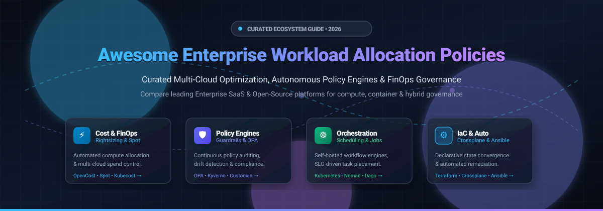
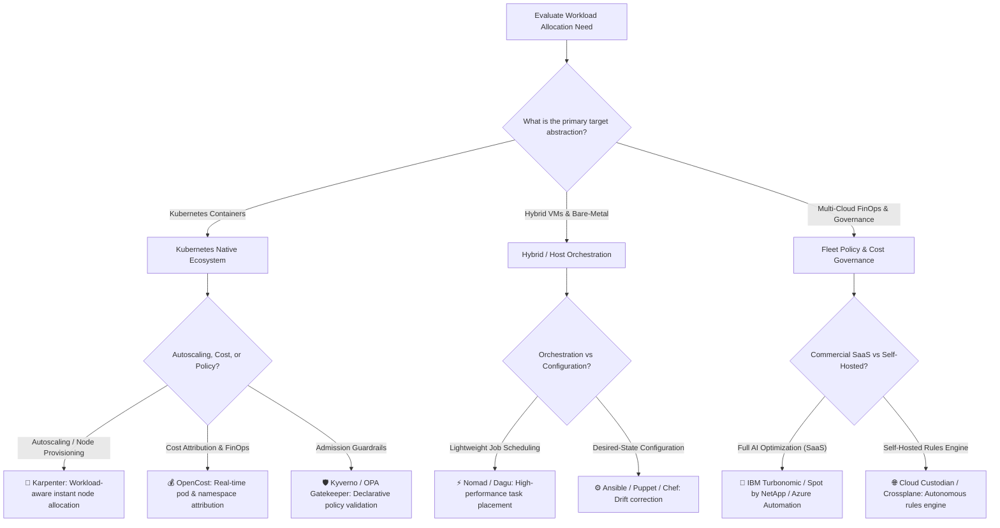

# 🚀 Awesome Enterprise Workload Allocation & Policies

  <strong>Curated Directory of Cloud Workload Management, Policy Engines, Infrastructure Automation &amp; FinOps Platforms</strong>

  
  
  
  
  
  
  

  <em>A definitive guide comparing leading enterprise SaaS platforms and battle-tested open-source projects for multi-cloud compute scheduling, autonomous resource optimization, Kubernetes admission guardrails, and infrastructure-as-code drift enforcement.</em>

---

## 📌 Table of Contents
- [🔍 Sector Overview & Market Dynamics](#-sector-overview--market-dynamics)
- [🏢 SaaS & Hosted Enterprise Platforms](#-saas--hosted-enterprise-platforms)
- [🌐 Open-Source GitHub Projects](#-open-source-github-projects)
- [🛠️ Architectural Guidance & Selection Framework](#%EF%B8%8F-architectural-guidance--selection-framework)
- [🤝 How to Contribute](#-how-to-contribute)
- [💖 Support & Sponsorship](#-support--sponsorship)
- [📈 Star History](#-star-history)
- [⚠️ Disclaimer](#%EF%B8%8F-disclaimer)

---

## 🔍 Sector Overview & Market Dynamics

The global **Cloud Management Platforms (CMP)** and **Enterprise Workload Optimization** market is valued at approximately **$7.3B–$10B+ in 2026** (projected to scale past **$15B–$50B+ by 2030** at a **16%–21% CAGR**), with dedicated cloud workload placement and cost optimization accounting for **~$2.9B**. 

The sector displays a **moderately fragmented yet tiered structure**:
* **Concentrated Foundation Core:** Hyperscale cloud providers (Microsoft Azure, Amazon AWS) and enterprise conglomerate suites (Broadcom/VMware, IBM) anchor base cloud spend and native workload allocation for Fortune 500 fleets.
* **Fragmented Specialized Edge:** The independent multi-cloud FinOps layer, Kubernetes dynamic scheduling, cloud-native policy guardrails, and self-hosted orchestration niches remain highly fragmented and innovative, fostering continuous feature development and strategic M&A consolidation.

---

## 🏢 SaaS & Hosted Enterprise Platforms

Enterprise SaaS solutions provide managed control planes, turnkey AI-driven resource rightsizing, automated elasticity, and enterprise SLO enforcement across hybrid multi-cloud topologies.

| Product | 🏢 Company Scale (Revenue / Valuation) | 📝 Description | 💳 Starting Pricing | 🎁 Free Tier / Free Trial Limits |
|---|---|---|---|---|
| **[Azure Automation](https://azure.microsoft.com/en-us/products/automation/)** | ~$3.9T Market Cap / ~$331.8B Rev (Microsoft) | **Cloud automation for process, configuration, and update management.** Enforces infrastructure state and orchestrates runbooks across Azure, hybrid clouds, and on-premises systems. | **$0.01 per minute** (job run time after monthly free allowance); Configuration Management at **$6.00/node/month** (for non-Azure nodes). | **Permanent Free Tier**: 500 process automation minutes/month; 5 non-Azure nodes for configuration management at no charge. |
| **[AWS Systems Manager](https://aws.amazon.com/systems-manager/)** | ~$2.88T Market Cap / ~$777B TTM Rev (Amazon) | **Unified AWS operational management.** Automation, Parameter Store, and change execution across AWS, hybrid server clusters, and edge infrastructure. | **$0.002 per step** (Automation tier) + **$0.00003/sec** for script execution steps; Advanced Parameters at **$0.05 per parameter/month**. | **Permanent Free Tier**: Standard Parameter Store parameters free; 100,000 standard automation steps/month free across all regions. |
| **[VMware vRealize Operations](https://www.vmware.com/)** | ~$1.66T Market Cap / ~$89.1B TTM Rev (Broadcom) | **AI-powered operations management for hybrid and multi-cloud.** Capacity planning, performance optimization, and policy-driven workload placement. | **£5,462 / year** (Standard edition, 25 VMs); Enterprise edition lists at **£22,732** (25 OS instances). | **Free Trial**: 60-day fully functional evaluation trial per deployed virtual appliance instance. |
| **[IBM Turbonomic](https://www.ibm.com/products/turbonomic)** | ~$235B Market Cap / ~$69.9B TTM Rev (IBM) | **AI-driven application resource management and cloud cost optimization.** Connects to AWS, Azure, GCP, Kubernetes, and on-premises virtualization to continuously optimize resource allocation without compromising performance. | **$800.00 per managed VM/year** (or ~$1,500/year via AWS Marketplace base SaaS contracts). | **Free Trial**: 30-day free trial with unlimited AWS, Azure, GCP accounts and unlimited managed virtual servers. |
| **[Morpheus Data](https://www.morpheusdata.com/)** | ~$60B Market Cap / ~$41.9B TTM Rev (HPE) | **Hybrid cloud application orchestration and management platform.** Self-service provisioning, governance, and day-2 operations across multi-cloud and on-premises bare-metal/VMs. | **$108.99 per concurrent workload element (WLE)/year** (volume tier 2,500–4,999 licenses); VM Essentials entry tiers from ~$125/socket/year. | **Free Community Edition & Trial**: Free non-commercial Community Edition limited to 3 sockets / up to 25 WLEs; 60-day enterprise evaluation trial. |
| **[Spot by NetApp (Flexera)](https://spot.io/)** | ~$36B Market Cap / ~$7.4B TTM Rev (NetApp / Flexera) | **Cloud workload optimization and automation.** Ocean (Kubernetes), Elastigroup (VM), and Eco (FinOps) products optimize compute spend and automated resource rightsizing. | **$1.415 per 100 vCPU-hours** (Spot instances via AWS Marketplace); or value-share starting at ~20% of net verified cloud savings. | **Free Trial & Tier**: 14-day full free trial on AWS Marketplace; freemium tier up to 20 managed virtual machines. |
| **[Chef Enterprise Automation](https://www.chef.io/)** | ~$1.8B Market Cap / ~$1.0B Rev (Progress Software) | **DevOps automation, orchestration, and auditing.** Chef Infra Client applies configuration policies to nodes with automated drift correction and InSpec auditing. | **$59.00 per node/year** (Chef Automate Business tier); Enterprise tier at **$189.00 per node/year**. | **Free Trial**: 60-day free trial for Chef Automate with complete feature access for evaluation. |
| **[Puppet Enterprise](https://www.puppet.com/)** | ~$750M ARR / ~$3.5B PE Valuation (Perforce Software) | **Infrastructure configuration management and policy enforcement.** Automates infrastructure across on-premises, cloud, and hybrid environments with RBAC and continuous compliance. | **$130.00 per node/year** (Standard tier, annual subscription, starting scale). | **Permanent Free Tier**: Up to 10 nodes free forever with full functionality; 30-day extended trial for larger environments. |
| **[CloudCheckr](https://www.cloudCheckr.com/)** | ~$700M ARR / ~$3.5B PE Valuation (Flexera) | **Cloud management platform for AWS and Azure.** Cost optimization, security, and compliance visibility across enterprise infrastructure. | **$500.00 per month** (usage-based starting tier for environments spending $500+/mo on cloud). | **Free Trial**: 14-day free trial with multi-cloud cost visibility and automated compliance scanning. |

---

## 🌐 Open-Source GitHub Projects

Self-hosted, transparent, and community-backed tools enabling granular workload orchestration, admission control guardrails, declarative infrastructure, and cost attribution without proprietary per-node licensing locks.

*Sorted in descending order by GitHub stargazers count:*

| 📦 Project | ⭐ Stars_Badge | 🏷️ Category | 📖 Description |
|---|---|---|---|
| **[Kubernetes](https://github.com/kubernetes/kubernetes)** |  | Container Orchestration | **The de facto container orchestration platform.** Enforces enterprise workload allocation natively using Resource Quotas, LimitRanges, PriorityClasses, and PodDisruptionBudgets across large-scale worker clusters. |
| **[Ansible](https://github.com/ansible/ansible)** |  | Infrastructure Automation | **Agentless configuration management and automation platform.** Uses declarative YAML playbooks over SSH to provision compute nodes, enforce system configuration policies, and audit infrastructure state. |
| **[Terraform](https://github.com/hashicorp/terraform)** |  | Infrastructure as Code | **The industry standard for declarative infrastructure-as-code.** Manages compute lifecycle, auto-scaling groups, and multi-cloud allocation policies across hundreds of cloud and hardware providers. |
| **[Nomad](https://github.com/hashicorp/nomad)** |  | Workload Orchestrator | **Flexible, lightweight workload scheduler for both containers and non-containerized legacy applications.** Supports batch, service, and system jobs across multi-region and hybrid cloud clusters with declarative placement rules. |
| **[Open Policy Agent (OPA)](https://github.com/open-policy-agent/opa)** |  | General Policy Engine | **Unified policy engine and Rego language runtime.** Decouples policy enforcement from service logic; powers Kubernetes admission control (via Gatekeeper), microservice authorization, API rate-limiting, and cloud compliance rules. |
| **[Crossplane](https://github.com/crossplane/crossplane)** |  | Cloud Native Control Plane | **Kubernetes-native framework for building custom internal cloud control planes.** Orchestrates cloud infrastructure, databases, and multi-tenant services alongside application workloads using Kubernetes CRDs and real-time reconciliation. |
| **[Kyverno](https://github.com/kyverno/kyverno)** |  | Kubernetes Policy Engine | **Kubernetes-native policy management engine.** Validates, mutates, generates, and verifies Kubernetes resources using idiomatic Kubernetes YAML policies—ideal for enforcing resource requests, memory limits, and security guardrails. |
| **[Chef Infra](https://github.com/chef/chef)** |  | Configuration Management | **Infrastructure-as-code platform utilizing recipes and cookbooks.** Enforces system policies and compliance continuously on managed nodes with automated drift correction and Chef InSpec security profiling. |
| **[Puppet](https://github.com/puppetlabs/puppet)** |  | Declarative Configuration | **Model-driven configuration management and continuous compliance platform.** Compiles declarative manifests into execution catalogs to enforce reproducible state and resource parameters across operating systems. |
| **[OpenCost](https://github.com/opencost/opencost)** |  | FinOps & Cost Allocation | **CNCF vendor-neutral Kubernetes cost monitoring and allocation specification.** Measures real-time compute, memory, GPU, and network spend down to individual pods, namespaces, labels, and controller workloads. |
| **[Cloud Custodian](https://github.com/cloud-custodian/cloud-custodian)** |  | Multi-Cloud Governance | **Lightweight rules engine for cloud fleet management.** Enforces cost optimization policies, auto-tags resources, shuts down idle non-production VMs off-hours, and continuously remediates compliance violations across AWS, Azure, and GCP. |
| **[Dagu](https://github.com/dagucloud/dagu)** |  | Workflow Orchestration | **Lightweight single-binary workflow and DAG orchestration engine with built-in RBAC and audit logging.** Executes multi-step batch workloads across Docker, shell, and Kubernetes with human approval checkpoints and secret masking. |
| **[Karpenter](https://github.com/kubernetes-sigs/karpenter)** |  | Dynamic Autoscaling | **Just-in-time, workload-aware Kubernetes node autoscaler.** Directly provisions exact-fit compute instances (including Spot, Graviton, and GPUs) tailored to pending pod requirements in seconds, minimizing infrastructure waste. |

---

## 🛠️ Architectural Guidance & Selection Framework

### 💡 Recommendation Matrix:
1. **For Container-First Fleets**: Combine **Kubernetes** with **Karpenter** (for just-in-time node bin-packing), **Kyverno** (for resource quota mutation and verification), and **OpenCost** (for granular cost visibility).
2. **For Hybrid Bare-Metal & VMs**: Deploy **Nomad** or **Dagu** for scheduling workloads without Kubernetes overhead, paired with **Ansible** for declarative configuration convergence.
3. **For Enterprise FinOps & Multi-Cloud Governance**: Pair **Cloud Custodian** for autonomous multi-cloud tag-based shutdowns with **Turbonomic** or **Spot by NetApp** for predictive ML-based rightsizing.

---

## 🤝 How to Contribute

We welcome community contributions, architectural comparisons, and new ecosystem tools!

1. 🍴 **Fork the repository** on GitHub.
2. 🌿 **Create a new branch**: `git checkout -b feature/add-new-tool`.
3. 📝 **Add or edit entries in `README.md`**: Follow the established table formatting, including specific pricing, precise free-tier limits, and official documentation links.
4. 📬 **Submit a Pull Request** with a concise description of why the tool fits the workload allocation and policy ecosystem.

---

## 💖 Support & Sponsorship

If you find this curated ecosystem guide valuable for your platform engineering, FinOps, or DevOps roadmap, please consider supporting the project:

- ⭐ **Star this repository** to help others discover it.
- 🍴 **Fork and share** it with your engineering team and DevOps community.
- ☕ **Sponsor the Maintainer**: [Buy a coffee and support open-source research via GitHub Sponsors](https://github.com/sponsors/ishandutta2007).

Your support enables continuous updates, in-depth benchmark comparisons, and maintenance of the open-source community directory!

---

## 📈 Star History

---

## ⚠️ Disclaimer

- This curated directory is compiled for educational and comparative architectural research.
- Product names, logos, and brands are property of their respective owners.
- Workload allocation platforms govern critical production infrastructure: **misconfigured allocation policies can result in compute starvation or unmanaged cloud spend**. Always test allocation thresholds in staging environments before deploying to production.
- Pricing metrics, marketplace rates, and software licensing tiers are subject to vendor change; always verify with official vendor documentation prior to purchasing.

---

  Maintained with ❤️ by <a href="https://github.com/ishandutta2007">Ishan Dutta</a> and the cloud-native open-source community.

